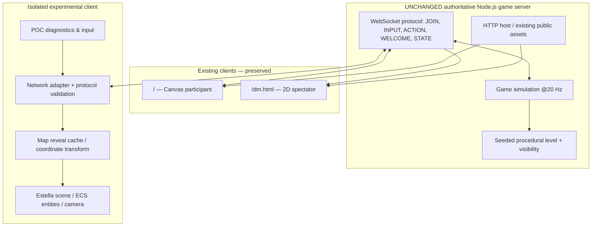

# Estella proof of concept — implementation and architecture plan

Status: Implemented POC / user review pending — see [evaluation](EVALUATION.md)
Date: 2026-11-13
Repository: BFH-coder01/DungeonHunter01
Branch: feature/estella-poc
Baseline: main, as of branch creation
Engine reference: https://github.com/esengine/estella
Owner: BFH-coder01

## Objective and non-negotiable constraints

Prove a second, web-capable Estella-based first-person client can display and navigate **the same server-authoritative, procedurally generated dungeon** while the existing player and Dungeon Master clients remain operational. This is a renderer/client experiment, **not** an engine migration or rewrite.

1. Do not modify the code on `main`; open a PR only after evidence and review.
2. Keep `npm start`, `/`, and `/dm.html` unchanged throughout the first POC.
3. Preserve `src/server/`, `src/shared/`, existing WebSocket messages, 20 Hz authoritative tick, server collision, inventory and combat.
4. Never make Estella authoritative for position, visibility, game outcomes, loot, or health.
5. Isolate experimental client and dependencies in `experiments/estella-client/` (or a separately served Vite development origin when necessary). Do **not** add Estella to the existing root package until explicitly approved.
6. Do not reuse commercial Dungeon Master graphics, music, game data or trademark in distributable assets without a licence.

## Verified current baseline

- `src/server/index.js`: Node HTTP static host on port 8080, WebSocket on same host, JOIN/SPECTATE paths, input/actions, 20 Hz snapshots; no build step.
- `src/server/game.js`: server-authoritative players, combat, movement and player fog of war.
- `src/server/dungeon.js`: generated 2D tiled floors, walls and stairs.
- `src/shared/constants.js`: TILE.WALL=0, FLOOR=1, STAIRS_DOWN=2, STAIRS_UP=3, TICK_HZ=20, PLAYER_RADIUS=0.32; MSG WELCOME/STATE/JOIN/SPECTATE/INPUT/ACTION.
- `src/shared/config.js`: `levels.fixed=1`, `revealAll=true`, dungeon width 64, height 44; POC must not silently alter these.
- `public/client.js`: player view using browser Canvas, WebSocket, reveal-delta map and positional audio.
- `public/dm.js`: read-only spectator, separate SPECTATE role, fully disclosed dungeon.
- `package.json`: Node >=20, only runtime dependency `ws`.

Estella upstream documentation: TypeScript SDK, ECS, C++/WASM rendering, 3D scene capability, editor/MCP tooling, Apache-2.0 for engine/runtime. The **separate editor is not open source**, and editor tooling is optional for the POC. Version, module APIs, web-build process, browser compatibility, asset support and performance **must be pinned and demonstrated**; upstream advertised support is not proof of suitability.

## Logical architecture



### Interfaces and ownership

| Contract | Producer | Consumer | Rule |
|---|---|---|---|
| Procedural tile map | server | player client | Server truth; player gets reveal deltas, not full secret map |
| Authoritative position, aim and health | server | player client | Estella transforms are **render-only** |
| Movement input / aim / actions | Estella client | server | Existing MSG.INPUT / MSG.ACTION shape; server validates |
| Game event and inventory | server | client | Same UI/state semantics as existing game |
| Spectator unrestricted map | server | existing DM | Keep SPECTATE read-only; do not expose to player client |
| Static files / build assets | experiment tooling | local development | Do not change legacy routes or root dependencies in Phase 1 |

### Geometry and coordinate contract

Current game position uses 2D tile coordinates (x,y), with x increasing horizontally and y down the map. Define explicit `toWorld(gameX,gameY)` and `toGame(worldX,worldZ)`; tentative mapping: world X = game x * tileSize; world Z = game y * tileSize; world Y is elevation. Centre tile geometry so player positions and collision align with legacy tile semantics. Confirm floor orientation/handedness, player height, facing angle sign and zero-direction with a fixture (straight hallway plus a right turn). Make tiles configurable, but initially use **1 world unit per tile** and refuse to copy physics results back to server.

Generate only revealed geometry for the participant client. For a 64x44 test map, use chunked/instanced wall surfaces if naive per-tile objects are too slow. Geometry should update incrementally when MSG.STATE.reveal arrives. Unseen tiles must not expose map topology, secret pickups or other hidden entities. Any experimental debug reveal must be local-only and disabled in acceptance builds.

### Data flow / protocol strategy

1. On a user gesture, open a WebSocket to the existing server and send `{type:"join",name}`.
2. On `welcome`, initialise seed/level/dimensions and an UNKNOWN-filled `Int8Array(width*height)`; do **not** assume welcome includes full map.
3. On `state`, apply reveal pairs, reconcile visible objects, cache server positions, and render interpolated transforms. Maintain null/absent fields safely; record protocol shape from real messages as a fixture.
4. Send only existing `{type:"input",mx,my,aim}` and `{type:"action", ...}` messages. Do not invent server endpoints or entity-authority messages.
5. At 20 Hz incoming snapshots, render at requestAnimationFrame cadence using buffering/smoothing; do not alter server tick.
6. On disconnect/reconnect, clear stale entities and state; no assumptions about stable player identity.
7. Do not use MSG.SPECTATE from the player client; no stealth admin/DM privilege changes.
8. Keep positional Web Audio re-use as a later stage after the core visual POC; do not regress existing audio.

### Proposed folder arrangement (not created yet)

```
docs/estella-poc/
  IMPLEMENTATION_PLAN.md
  DECISIONS_RISKS_TESTS.md
experiments/estella-client/               # later implementation commit only
  README.md
  package.json
  src/
    main.ts
    net/protocol.ts
    net/socket.ts
    world/map-cache.ts
    world/coordinate-transform.ts
    world/geometry.ts
    world/remote-entities.ts
    input/controls.ts
    ui/diagnostics.ts
  tests/
    map-cache.test.ts
    coordinate-transform.test.ts
    protocol-fixtures.test.ts
```

## Implementation work packages and gates

| Package | Change | Deliverable | Exit gate |
|---|---|---|---|
| WP0 Baseline & isolation | Capture main SHA; verify npm install/start and legacy views, record screenshot and 2-player connection | Baseline report and exact upstream Estella version/commit | Legacy still functional; no source changes |
| WP1 Engine spike | Standalone Estella web demo (one room, camera, movement, walls, lighting) | Build instructions, captured browser run, unsupported APIs noted | Successful clean build/run on Windows browser |
| WP2 Protocol adapter | WebSocket JOIN/WELCOME/STATE, validated snapshots and diagnostics | First new client appears as an ordinary server player | Server unchanged, DM and legacy client continue |
| WP3 Procedural map | Incremental reveal-driven tile-to-geometry conversion, correct axis and camera | Real map in Estella | Same seed/map and collision-aligned positions |
| WP4 Multiplayer rendering | Remote player entities and interpolation | Two ordinary clients + DM simultaneously | Stable 20Hz authority, no divergence |
| WP5 Interaction spike | One existing attack and one cache/item pickup via existing ACTION messages | Observed authoritative state updates | No client-origin fabricated game state |
| WP6 Evaluation | FPS, memory, startup, regression, security, compatibility and licensing evidence | Go/no-go report | All required gates met or explicit no-go |

Keep multi-level, mobile controls, upgraded DM controls, new animations/graphics and migration of audio **out of POC scope**. They can be candidates for a subsequent release.

## Acceptance tests (planned, not executed)

| ID | Method | Pass criteria |
|---|---|---|
| T01 Baseline | On `main`, `npm install && npm start` | Existing game loads on `/` and `/dm.html`, no changes required |
| T02 Branch isolation | `git diff main...feature/estella-poc` | POC files only; zero changes to server/shared/legacy client on the POC branch |
| T03 Build reproducibility | Clean Windows checkout and pinned Estella dependency | Install, build and run from recorded instructions without manual hacks |
| T04 Engine basics | 3D room/corridor smoke test | Camera, lighting, floor/walls render; no fatal errors |
| T05 Player join | WebSocket to unmodified server | WELCOME and STATE arrive; no duplicate player spawn |
| T06 Map integrity | Fixed seed protocol fixture; compare revealed tile layout | No wrong tile type, shift, mirrored axis or disclosed unseen map |
| T07 Movement and collision | Walk to corners/walls, compare legacy and Estella positions | Server rejects passing through walls; displayed position follows server; no sustained drift >0.25 tile after settling |
| T08 Multiplayer | Legacy player + Estella player + DM for 10 min | Both visible to DM; no disconnects or crashes; legacy controls work |
| T09 Snapshot rendering | Capture 20 Hz updates / frame samples | No server tick changes; frames smooth enough for navigation |
| T10 Action authority | Attack/pickup via existing MSG.ACTION | Server adjudicates result; no client-side health/item authority |
| T11 Fog security | With `revealAll=false` in isolated test copy only | Unknown tiles/loot invisible to Estella until revealed; original config restored |
| T12 Regression | Repeat all legacy smoke paths after experimental client work | No new regressions in legacy /, /dm.html, inventory, combat or audio |
| T13 Runtime performance | Desktop Windows browser, real 64x44 map, 2+ clients | Target median >=60 FPS, 1% low >=30 FPS; record hardware/browser and actual values |
| T14 Memory and startup | Browser profiler and cold load | Record peak WASM/JS memory, load time and bundle size; no sustained growth during 15-minute run |
| T15 Robustness | Disconnect/reconnect; malformed WebSocket snapshot in adapter fixture | Clean UI recovery; no crash/hang or privileged protocol operations |
| T16 Licensing | Record engine version and asset provenance | Apache obligations captured; no unlicensed Dungeon Master assets or Spine usage |

Performance targets are **proposed thresholds**, not measured results. For a mobile release, set separate thresholds later. Tests must be marked PASS/FAIL/BLOCKED with linked logs/screenshots/commit SHA.

## Go / no-go decision

GO only if T01–T12 and T16 pass, T13–T14 measurements are acceptable and reproducible, and security/licensing issues have owners. Otherwise keep existing game untouched, document obstacles, and stop or change engine. No automatic merge to `main`; PR requires explicit review, regression evidence and rollback instructions.

## Rollback

The POC is additive: remove or stop the experimental development server/client, leave root npm scripts and port 8080 unchanged, and run `npm start` from `main`. The existing server and clients remain the supported game. Never force-push `main`.

## Evidence template

Record: UTC timestamp; git SHA for DungeonHunter01; Estella release/commit; Node/browser/OS/GPU; commands; server logs; browser console; screenshot/video; protocol fixture hash; FPS percentile; peak WASM/JS memory; PASS/FAIL/BLOCKED per test; issue links and recommended next action.

## References

- Existing baseline: https://github.com/BFH-coder01/DungeonHunter01/blob/main/README.md
- Existing server: https://github.com/BFH-coder01/DungeonHunter01/blob/main/src/server/index.js
- Existing game: https://github.com/BFH-coder01/DungeonHunter01/blob/main/src/server/game.js
- Existing constants: https://github.com/BFH-coder01/DungeonHunter01/blob/main/src/shared/constants.js
- Estella upstream: https://github.com/esengine/estella
- Estella documentation: https://estellaengine.com/docs
