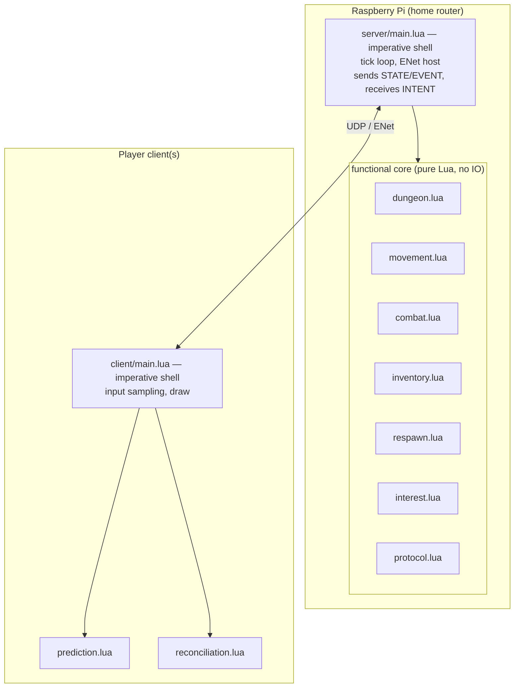
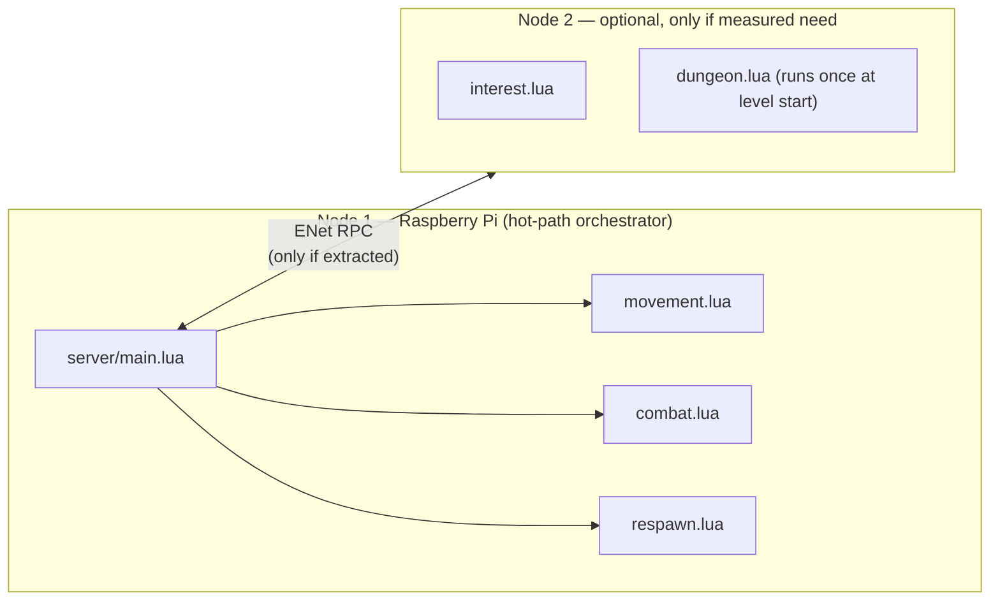

# DungeonHunter v02 — Architecture

Status: proposal, matches the scaffold in `v02-lovr/`. v01 (`src/`, `public/`)
is unaffected and remains playable.

## Governing principle: functional core, distributable shell

Every piece of server (and client) logic is decomposed into small
**functional units**: given explicit inputs (state + intent), they produce
explicit outputs (new state + events), with no hidden mutation of globals and
no direct network/IO calls inside the unit itself. That gives two things at
once:

1. **Testability** — a unit's precondition/process/postcondition contract can
   be exercised by an automated test harness with no LÖVR runtime, no
   network, and no GPU, because the unit is just a function.
2. **Distributability** — because a unit only touches its explicit
   inputs/outputs, it can be called in-process today and moved behind a
   message boundary (ENet RPC to another node) later, without changing the
   unit itself. Only the orchestrator that wires units together needs to
   change.

This is a "functional core, imperative shell" split:

- **Functional core** (pure units): dungeon generation, movement validation,
  combat resolution, damage/inventory rules, respawn selection, interest
  management/snapshot filtering, protocol encode/decode, client prediction,
  client reconciliation. See `design.md` for each unit's contract.
- **Imperative shell** (thin, impure adapters): the ENet host/peer wrappers,
  the per-tick orchestrator that calls units in sequence and performs the
  actual `send`, disk/config loading. These are integration-tested against a
  real (or scripted) transport, not unit-tested in isolation.

## Deployment topology

### Now: single-node

Rendered live at [mermaid.live](https://mermaid.live) — paste the block below.

All functional-core calls are direct Lua function calls — no network hop
inside a tick. This keeps the authoritative simulation on one consistent
timeline, which a real-time dungeon crawler needs; see the "why not distribute
by default" note below.

### Later (optional): mesh-capable, only if hardware demands it

Because each unit has an explicit in/out contract, a specific unit *can* be
extracted behind an ENet RPC boundary and run on a second node without
touching the unit's own code — only the orchestrator changes, from a direct
call to a network call + response. Candidates, if ever needed:

- **Interest management / snapshot filtering** — CPU-bound, per-player,
  parallelizable, and tolerant of a few extra ms of latency (it runs once per
  tick per player, not once per input).
- **Dungeon generation** — runs once at level start, not on the hot path at
  all, so it's the cheapest possible thing to move off-node.

Not planned as default candidates: movement validation, combat resolution,
respawn selection — these sit on the authoritative hot path where an
inter-node round trip would show up as added input latency, and a single Pi
has no trouble running them in-process.

**We are not building this mesh split now.** It's a deliberate non-goal
until there's a concrete second device and a measured reason (CPU headroom,
not novelty) to move a specific unit off the Pi. See `roadmap.md` Delivery 9.

## Why not distribute by default

A dungeon crawler's authoritative tick needs one consistent view of world
state per tick. Splitting the hot-path units (movement, combat) across
physical nodes turns in-process function calls into network calls on the
critical path, adds partial-failure modes (node reachable, but mid-tick), and
buys nothing at "one Pi on a home LAN, a handful of players" scale. The
functional-unit contracts keep that option open without paying for it today.

## Relationship to v01

v02 keeps v01's non-negotiables (see repo `CLAUDE.md`):

- Server is authoritative; clients send intent only, never position/health/
  damage/inventory.
- Alive opponents carry no name/health overlay in the player view; a fallen
  opponent reveals their name during the respawn window.
- The DM/spectator role sees complete, unfiltered state.
- The two known v01 correctness issues (event-clearing order,
  pickup-before-capacity-check) are being designed out at the unit level in
  v02 rather than ported forward — see `design.md` for `inventory.pickup` and
  the orchestrator's event-queue contract.

v02 departs from v01 on transport (ENet/UDP vs `ws`/TCP) and client runtime
(native LÖVR vs browser), per the earlier architecture discussion in this
session.

## Cross-references

- `design.md` — per-unit precondition/process/postcondition contracts,
  interfaces, and test approach.
- `roadmap.md` — delivery breakdown, each scoped so it can be handed to a
  separate agent with a self-contained acceptance test.
- `README.md` — track status and current file inventory.
