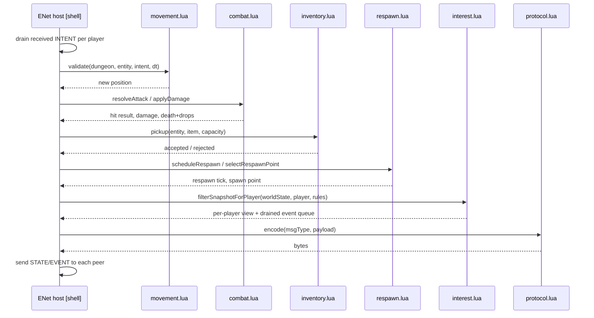

# DungeonHunter v02 — Design

Component-level contracts. Each functional unit is specified as
**precondition → process → postcondition**, with an explicit interface and a
test approach, per `architecture.md`'s functional-core/imperative-shell
split. Units are pure Lua modules (no `lovr.*`, no `enet`, no globals) unless
marked **[shell]**.

Test harness: [busted](https://lunarmodules.github.io/busted/) (standard Lua
unit-test framework) can run every pure unit with plain `lua`/`luajit` — no
LÖVR install required, matching how this session already syntax-checked the
scaffold with `luac5.1`. **[shell]** units need an integration harness that
runs under the actual LÖVR runtime; not covered by `busted`.

---

## `dungeon.lua` — `generate(seed, params)`

- **Preconditions**: `seed` is an integer; `params` supplies room/corridor
  counts and bounds equivalent to v01's `src/shared/config.js` dungeon
  tuning.
- **Process**: deterministically generates rooms, corridors, spawn points,
  caches, stairs, and ambient sound points from `seed` alone (ports
  `src/server/dungeon.js`).
- **Postconditions**: returns a `DungeonMap` table; calling twice with the
  same `seed`/`params` returns bit-identical output (determinism is the
  contract, not just "a dungeon").
- **Test approach**: `busted` — same-seed-same-output, spawn points are
  reachable, no overlapping geometry, cache/stair counts match `params`.

## `movement.lua` — `validate(dungeon, entity, intent, dt)`

- **Preconditions**: `entity.pos` is a last-known-good authoritative
  position; `intent` is client-submitted (untrusted) direction/speed; `dt` is
  the server tick interval.
- **Process**: integrates `intent` against `entity.pos` bounded by
  `entity.maxSpeed`, resolves collision against `dungeon` geometry. Never
  trusts a position from `intent` — v01's authoritative-position rule, at the
  unit level.
- **Postconditions**: returns a new position that is (a) reachable from
  `entity.pos` within `dt * maxSpeed`, and (b) not inside solid geometry.
  Malformed/adversarial `intent` (huge magnitude, NaN) degrades to "no
  movement," never a crash or a teleport.
- **Test approach**: `busted` — legal move accepted, over-speed move clamped,
  move into a wall rejected, NaN/huge-magnitude intent produces unchanged
  position.

## `combat.lua` — `resolveAttack(attacker, target, weapon, hasLineOfSight)` / `applyDamage(entity, amount)`

- **Preconditions**: `attacker`/`target` are authoritative entity states;
  `weapon` carries range/cooldown/damage from `src/shared/items.js`-equivalent
  data; `hasLineOfSight` is a boolean already computed by the orchestrator
  against `dungeon` (kept out of this pure unit so it stays testable without
  geometry raycasting fixtures).
- **Process**: `resolveAttack` checks range, forward-dot targeting, cooldown
  elapsed, and `hasLineOfSight`, returning whether the attack lands.
  `applyDamage` reduces health, and on lethal damage returns a `died = true`
  event plus the entity's drop list — it does not touch the world (drop
  placement is the orchestrator's job).
- **Postconditions**: `resolveAttack` never mutates `attacker`/`target`; it
  returns `{hit, reason}` so a rejected attack is debuggable. `applyDamage`
  is total for any `amount >= 0` and never produces negative health.
- **Test approach**: `busted` — in-range/out-of-range, cooldown not elapsed,
  no line of sight, lethal damage returns correct drop list, non-lethal
  damage leaves entity alive with clamped health.

## `inventory.lua` — `pickup(entity, item, capacity)`

- **Preconditions**: `entity.inventory` and `capacity` reflect current slot
  rules; `item` is the world entity (cache roll or floor drop) being
  targeted.
- **Process**: checks capacity **before** returning a "consume the world
  item" instruction. This is the fix for v01 known-issue #2
  (`doPickup()` marking a cache looted before checking capacity, destroying
  non-boon items on a full inventory) — designed correctly from the start
  rather than ported forward.
- **Postconditions**: returns `{ accepted: true, entity' }` only when
  capacity allows it; on a full inventory returns `{ accepted: false }` and
  the caller (orchestrator) must leave the world item untouched. The unit
  never has side effects on world state itself — that asymmetry is the point
  of the fix.
- **Test approach**: `busted` — pickup into free slot accepted, pickup with
  full inventory rejected and world item presumed untouched by caller
  contract, boon-type items (if stackable/exempt) follow their own rule.

## `respawn.lua` — `scheduleRespawn(deathTick, respawnDelayTicks)` / `selectRespawnPoint(dungeon, occupied)`

- **Preconditions**: `deathTick` is the tick a death event was resolved on;
  `occupied` is the set of currently-occupied spawn points.
- **Process**: mirrors v01's three-second respawn timer and "another
  suitable spawn point" rule, expressed as pure tick arithmetic and spawn
  selection.
- **Postconditions**: `scheduleRespawn` returns a tick number strictly after
  `deathTick`; `selectRespawnPoint` never returns a point in `occupied`
  (falls back to least-recently-occupied if all points are occupied, rather
  than erroring).
- **Test approach**: `busted` — respawn tick offset is correct, spawn
  selection avoids occupied points, degrade behavior when all points are
  occupied.

## `interest.lua` — `filterSnapshotForPlayer(worldState, player, visibilityRules)`

- **Preconditions**: `worldState` is the full authoritative tick state;
  `player` identifies the viewer; `visibilityRules` encodes the policy (v01
  parity: alive opponents unlabeled, killed opponents reveal name during the
  respawn window, DM sees everything unfiltered).
- **Process**: produces the subset of `worldState` that `player` is allowed
  to receive — this is the enforcement point for "the browser/client must
  never receive data outside the player's allowed visibility," moved from
  "trust the client to not render it" (v01's `CONFIG.revealAll` test
  scaffolding) to "the server never sends it."
- **Postconditions**: output contains no field of an alive opponent's
  name/health; a DM-role viewer's output is the unfiltered `worldState`.
  Idempotent — filtering an already-filtered view changes nothing further.
- **Test approach**: `busted` — alive opponent has no name/health in player
  output, downed opponent has name within the respawn window and not after,
  DM output matches full `worldState` exactly.

## `protocol.lua` — `encode(msgType, payload)` / `decode(bytes)` **(extends the existing scaffold)**

- **Preconditions**: `msgType` is one of the `MSG` constants already defined
  in `shared/protocol.lua`; `payload` matches that message's documented
  shape.
- **Process**: serializes/deserializes without touching the network — this
  is what lets the ENet **[shell]** layer stay a thin adapter.
- **Postconditions**: `decode(encode(t, p))` round-trips to an
  equivalent `(t, p)` for every defined message type; malformed bytes decode
  to an explicit error value, never a Lua error/crash (the shell receives
  untrusted bytes from the network and must not be able to be crashed by
  them).
- **Test approach**: `busted` — round-trip for every `MSG` type, malformed/
  truncated bytes produce the explicit error value, oversized payloads are
  rejected before decode completes.

## `prediction.lua` (client) — `predictMovement(localState, intent, dt)`

- **Preconditions**: `localState` is the client's last-known position/
  velocity; `intent` is local input for this frame.
- **Process**: applies the same integration rule as `movement.lua` so the
  client's prediction and the server's authoritative result converge under
  identical input — this unit should share its integration math with
  `movement.lua` rather than reimplementing it, to avoid the two silently
  diverging.
- **Postconditions**: deterministic given identical `(localState, intent,
  dt)`.
- **Test approach**: `busted` — given fixed inputs, matches
  `movement.validate`'s displacement for the same intent (cross-checked
  against the server unit, not just self-consistent).

## `reconciliation.lua` (client) — `reconcile(predictedState, serverSnapshot)`

- **Preconditions**: `predictedState` is the client's current predicted
  local state; `serverSnapshot` is the latest authoritative `STATE` message
  for this player.
- **Process**: corrects `predictedState` toward `serverSnapshot`, replaying
  any locally-predicted input newer than the snapshot's tick (standard
  client-side prediction/reconciliation).
- **Postconditions**: when `serverSnapshot` and `predictedState` already
  agree, output equals `predictedState` unchanged (no jitter on agreement).
- **Test approach**: `busted` — snapshot matching prediction is a no-op,
  snapshot diverging from prediction snaps/interpolates toward server truth
  without discarding un-acknowledged newer input.

---

## Shell components (integration-tested, not unit-tested)

Per-tick call order in `server/main.lua`, rendered live at
[mermaid.live](https://mermaid.live):

- **`server/main.lua` [shell]** — ENet host, connect/disconnect/receive
  handling, tick loop that calls the functional core in order:
  `movement.validate` → `combat.resolveAttack`/`applyDamage` →
  `inventory.pickup` → `respawn` bookkeeping → `interest.filterSnapshotForPlayer`
  → `protocol.encode` → send. Test approach: scripted-peer integration test
  (fake ENet peers feeding known `INTENT` sequences, asserting resulting
  `STATE`/`EVENT` bytes), run under the real LÖVR runtime since this
  environment has none installed.
- **`client/main.lua` [shell]** — ENet peer, input sampling, calls
  `prediction.lua`/`reconciliation.lua`, draws. Test approach: manual
  play-test (per `README.md`'s "untested, verify locally" note) plus the
  same scripted-peer technique against a stub server for connect/disconnect
  handling.

## Event-ordering fix (v01 known-issue #1, designed out)

v01's `Game.tick()` clears `this.events` before snapshot fan-out, dropping
events emitted between ticks. In v02 this is avoided structurally: the
orchestrator's per-tick event queue is drained *into* the `STATE`/`EVENT`
messages during the same pass that builds them (`interest.filterSnapshotForPlayer`
consumes the queue as part of producing its output), so there's no separate
"clear" step that can run before send. Covered by the shell integration test
above (assert no event is present in the queue after a tick that produced a
snapshot referencing it, and no event is silently dropped across two
consecutive ticks).
