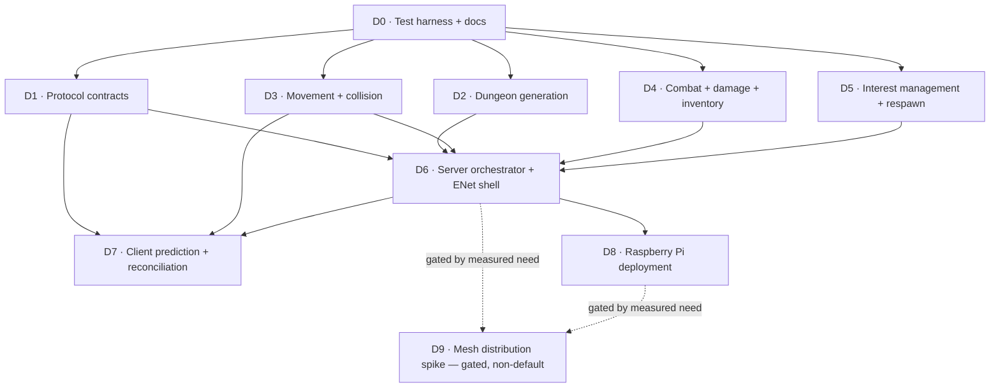

# DungeonHunter v02 — Roadmap

Sequencing overview for `v02-lovr/`. For the full self-contained
precondition/process/postcondition packet an executing agent needs for any
item below, see **`delivery.md`** — that's the dispatch document; this file
is just the ordering and parallelism picture.

## Dependency graph

Rendered live at [mermaid.live](https://mermaid.live).

## Parallel workstreams

`D1`, `D2`, `D3`, `D4`, `D5` each touch their own files and spec, depend
only on `D0`, and don't depend on each other — five agents can take these
simultaneously on separate branches once `D0` merges:

| Branch | Delivery | Files |
|---|---|---|
| `feature/protocol` | D1 | `shared/protocol.lua`, `spec/protocol_spec.lua` |
| `feature/dungeon` | D2 | `server/dungeon.lua`, `spec/dungeon_spec.lua` |
| `feature/movement` | D3 | `server/movement.lua`, `spec/movement_spec.lua` |
| `feature/combat` | D4 | `server/combat.lua`, `server/inventory.lua`, `spec/combat_spec.lua`, `spec/inventory_spec.lua` |
| `feature/interest` | D5 | `server/interest.lua`, `server/respawn.lua`, `spec/interest_spec.lua`, `spec/respawn_spec.lua` |

`D6` is the single integration point (needs D1–D5 all merged) and the first
delivery requiring a real LÖVR runtime. `D7` and `D8` follow sequentially
from `D6`. `D9` is explicitly gated — not to be started speculatively.

## Access requirements by delivery

| Delivery | Needs LÖVR runtime? | Needs physical hardware? |
|---|---|---|
| D0–D5 | No — pure Lua, `busted` only | No |
| D6 | Yes | No |
| D7 | Yes (wiring); human for manual play-test | No |
| D8 | Yes (build step) | Yes — a Raspberry Pi |
| D9 | Yes | Yes — a second node |

None of D0–D5 are runnable/verifiable claims without actually running
`busted`; D6 onward are not verifiable in a sandbox without LÖVR/hardware
present — see `delivery.md` for exactly what each packet's acceptance test
requires.
